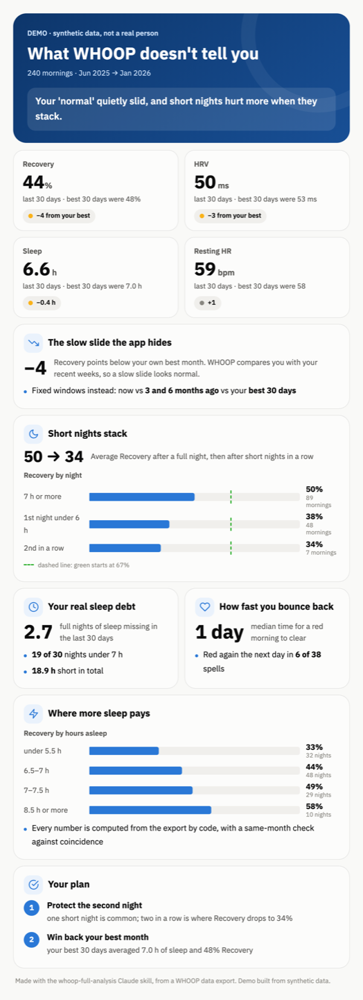
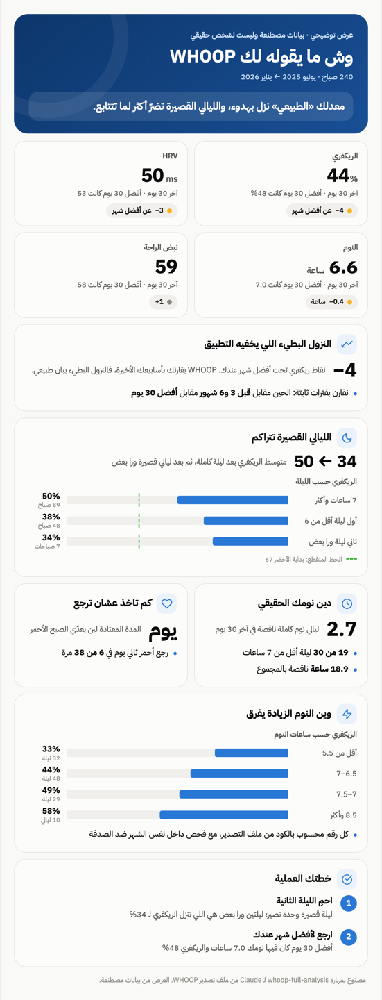

# What WHOOP doesn't tell you

**A Claude skill that reads your full WHOOP export and finds the patterns the app never spells out — in your own numbers, in your own language.**

[English](#english) · [العربية](#العربية)

[](#install) [](#any-language) [](LICENSE)

<p align="center"></p>
<p align="center"><sub>Demo built by the skill from <b>synthetic</b> data — not a real person.</sub></p>

---

## English

WHOOP gives you a score every morning. It doesn't tell you **why it moved**, what your **real normal** is, or **which one change would move it most**. Your export already holds the answers — this skill digs them out.

### 10 things the WHOOP app won't tell you

| | The hidden pattern | Why the app misses it |
|---|---|---|
| 1 | **The slow slide.** Your HRV, resting HR, Recovery and sleep now vs 3 and 6 months ago vs your best 30 days. | WHOOP compares you with your recent weeks, so a slow decline becomes your new "normal". |
| 2 | **One short night costs you twice.** The second morning after a short night, not just the first. | The app scores one day at a time. |
| 3 | **Short nights stack.** Recovery after one, then two short nights in a row. | Streaks aren't shown. |
| 4 | **Your bounce-back time.** How many days a red morning takes to clear, and how often it comes back. | No recovery-from-red timeline. |
| 5 | **Bedtime vs hours.** Same hours of sleep, early vs late bedtime — does the clock matter for you? | Bedtime and duration are mixed together. |
| 6 | **Late workouts.** What a workout close to bedtime does to your sleep and the next morning. | Workouts and sleep live on different screens. |
| 7 | **The days WHOOP never sees.** Missing days by weekday — are your worst days the ones left out of your averages? | Averages silently skip them. |
| 8 | **Your real sleep debt.** The last 30 days in one number: nights under 7 h and the full nights you're missing. | Sleep debt resets daily. |
| 9 | **Weekend jet lag.** How far your body clock moves every weekend, and what the first work day after it costs. | Not measured. |
| 10 | **Where more sleep stops paying.** The hours where your Recovery stops improving — your personal sweet spot. | No dose-response curve. |

Then it ranks **your top 3 levers** — the changes expected to move your average Recovery the most, with an estimated gain each — and turns the best one or two into a **14-day protocol** with one target number and a re-check date.

### Numbers you can trust

- **Exact:** every number is computed by code from your raw export — never estimated or read off a chart.
- **Nothing ignored:** every file, column and day is used or accounted for, with a coverage table and a self-check.
- **Not fooled by time:** every link is re-tested inside the same month, so a new routine, a season or a new strap can't fake a pattern.
- **Honest wording:** each finding is labelled *clear link*, *possible signal*, *between periods only* or *not enough data* — no p-values, no overclaiming.
- **Context aware:** wear gaps, partial-wear days, travel and time zones, Ramadan, your local weekend, and WHOOP's 2025 strap and sleep-algorithm changes.

### What you get

- **A full report** — 13 sections, from "your normal" to "what moves your Recovery", written for a non-specialist.
- **Two one-page briefs** for your phone (PNG + PDF): your summary, and *What WHOOP doesn't tell you* (like the demo above).
- **A daily morning check** — send a screenshot of today's WHOOP screen and get today's plan against *your* baseline in six lines.

### Any language

- The report, briefs and pages follow the language you write in — English, Arabic, Spanish, French, Japanese, Urdu, Hebrew… — right to left where needed.
- WHOOP exports in English or Arabic are read directly; exports in any other app language are mapped once with a small file the skill prepares for you.

### Install

**Claude app / claude.ai:** download `whoop-full-analysis.zip` from [Releases](../../releases/latest), then *Settings → Capabilities → Skills → Upload skill*.

**Claude Code:**

```bash
npx skills add Sulaimannnnnn/Whoop-full-analysis
```

or copy `skills/whoop-full-analysis` into `~/.claude/skills/`.

### Use it in 3 steps

1. In the WHOOP app: **menu → Data Export → whole period → Export**. You get an email with a ZIP.
2. Upload the ZIP to Claude as it is.
3. Ask, for example:
   - *"Analyse my WHOOP data — what doesn't the app tell me?"*
   - *"Why is my Recovery lower than it used to be?"*
   - *"Does eating late actually affect my sleep?"*
   - *"Morning check"* (with a screenshot of today's screen)

### Requirements

Python 3 with `pandas` and `numpy`. Optional: `scipy`, `matplotlib` (charts), `playwright` (PNG/PDF briefs; without it you get HTML).

### Privacy

This repository contains no health data. Your export is analysed inside your own Claude session.

### Disclaimer

- Independent project, not affiliated with or endorsed by WHOOP. WHOOP is a trademark of its owner.
- WHOOP is a wellness device, not a diagnostic one. This skill does not diagnose and does not replace a doctor.
- Links are correlations in your own data, not proof of cause; levers are estimates, not promises.

---

## العربية

# وش ما يقوله لك WHOOP

**مهارة لـ Claude تقرأ ملف تصدير WHOOP كامل وتطلع لك الأنماط اللي التطبيق ما يقولها — بأرقامك أنت، وبلغتك.**

<p align="center"></p>
<p align="center"><sub>عرض صنعته المهارة من بيانات <b>مصطنعة</b> — مو لشخص حقيقي.</sub></p>

WHOOP يعطيك رقم كل صباح، بس ما يقول لك **ليش تغيّر**، ولا وش **معدلك الحقيقي**، ولا **أي تغيير واحد** يفرق معك أكثر. الجواب موجود في ملف التصدير، والمهارة تطلّعه.

### 10 أشياء ما يقولها لك التطبيق

1. **النزول البطيء:** HRV ونبض الراحة والريكفري والنوم الحين مقابل قبل 3 و6 شهور ومقابل أفضل 30 يوم عندك — لأن WHOOP يقارنك بأسابيعك الأخيرة، فالنزول البطيء يصير «طبيعي».
2. **الليلة القصيرة تكلفك مرتين:** أثرها على الصبح الثاني، مو بس الأول.
3. **الليالي القصيرة تتراكم:** الريكفري بعد ليلة قصيرة، ثم ليلتين ورا بعض.
4. **كم تاخذ عشان ترجع:** كم يوم يحتاج الصبح الأحمر عشان يعدّي، وكم مرة يرجع.
5. **موعد النوم أو عدد الساعات؟** نفس الساعات، نومة بدري مقابل متأخرة.
6. **التمرين المتأخر:** وش يسوي التمرين القريب من النوم بنومك وبالصبح اللي بعده.
7. **الأيام اللي WHOOP ما يشوفها:** الأيام الناقصة حسب أيام الأسبوع — هل أسوأ أيامك هي اللي طايحة من معدلاتك؟
8. **دين نومك الحقيقي:** آخر 30 يوم برقم واحد: كم ليلة أقل من 7 ساعات، وكم ليلة كاملة ناقصتك.
9. **جت لاق الويكند:** كم تتحرك ساعتك البيولوجية كل ويكند، وكم يكلفك أول يوم دوام.
10. **وين النوم الزيادة يوقف يفرق:** نقطة الساعات اللي بعدها الريكفري ما يتحسن عندك.

وبعدها ترتّب لك **أقوى 3 روافع** — التغييرات اللي يُتوقع منها أكبر فرق في متوسط الريكفري مع تقدير لكل وحدة — وتحوّل أقواها إلى **بروتوكول 14 يوم** برقم مستهدف وموعد إعادة فحص.

### أرقام تقدر تثق فيها

- **دقيقة:** كل رقم محسوب بالكود من ملفك، بدون تقدير بالنظر.
- **ما تتجاوز شيء:** كل ملف وعمود ويوم مستخدم أو مذكور سبب تركه، مع جدول تغطية وفحص ذاتي.
- **ما تنخدع بالوقت:** كل علاقة تُعاد داخل نفس الشهر، عشان روتين جديد أو موسم أو إسوارة جديدة ما تصنع نمط وهمي.
- **كلام صادق:** كل نتيجة موسومة: علاقة واضحة، إشارة محتملة، تظهر بين الفترات فقط، أو البيانات ما تكفي.
- **تفهم سياقك:** فجوات اللبس، السفر، رمضان، الويكند حسب بلدك، وتحديثات WHOOP لعام 2025.

### وش تاخذ

- **تقرير كامل** من 13 قسم بلغة واضحة لغير المتخصص.
- **ملخصين مصوّرين** للجوال (صورة + PDF): ملخصك، و«وش ما يقوله لك WHOOP» مثل الصورة فوق.
- **فحص الصباح:** صوّر شاشة WHOOP اليوم وخذ خطة يومك مقارنة بمعدلك أنت في 6 أسطر.

### بأي لغة

التقارير والملخصات بلغتك أنت، من اليمين لليسار عند الحاجة. والتصدير يُقرأ بأي لغة للتطبيق: الإنجليزي والعربي مباشرة، وغيرهما بملف مطابقة تجهّزه المهارة.

### التثبيت

**تطبيق Claude / claude.ai:** نزّل `whoop-full-analysis.zip` من [Releases](../../releases/latest)، ثم الإعدادات ← Capabilities ← Skills ← Upload skill.

**Claude Code:**

```bash
npx skills add Sulaimannnnnn/Whoop-full-analysis
```

### الاستخدام في 3 خطوات

1. من تطبيق WHOOP: **القائمة ← Data Export ← كامل الفترة ← Export**، ويوصلك إيميل فيه ملف ZIP.
2. ارفع الملف لـ Claude مثل ما هو.
3. اسأل مثلاً: «حلل بيانات WHOOP حقتي، وش اللي ما يقوله لي التطبيق؟» أو «ليش الريكفري عندي صار أقل من قبل؟» أو «فحص الصباح» مع صورة الشاشة.

### الخصوصية وإخلاء المسؤولية

المستودع ما فيه أي بيانات صحية، وبياناتك تُحلَّل داخل جلستك فقط. مشروع مستقل غير تابع لشركة WHOOP. WHOOP جهاز عافية لا جهاز تشخيص، والمهارة لا تشخّص ولا تغني عن الطبيب. العلاقات ارتباطات من بياناتك لا إثبات سببية، والروافع تقديرات لا وعود.

---

Icons in the visual brief: [Feather](https://feathericons.com) (MIT).

## License · الترخيص

[MIT](LICENSE) — حر الاستخدام والتعديل والنشر مع إبقاء إشعار الحقوق. Free to use, modify and share, provided the copyright notice is kept.
